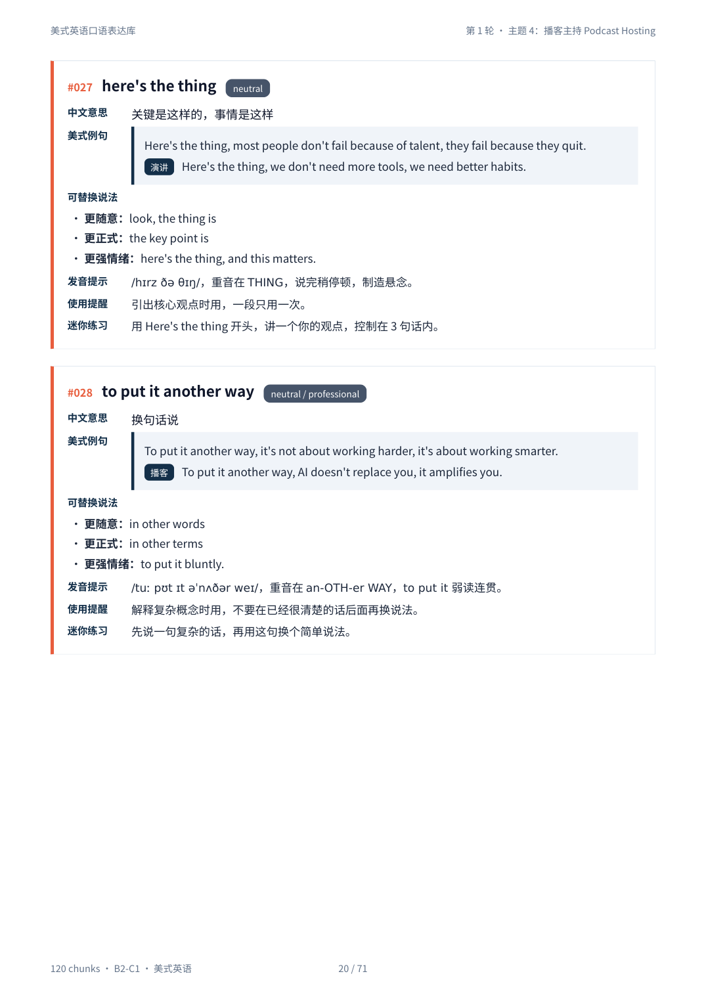
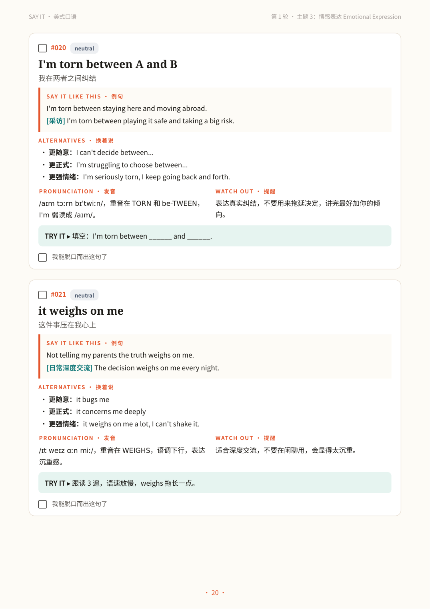
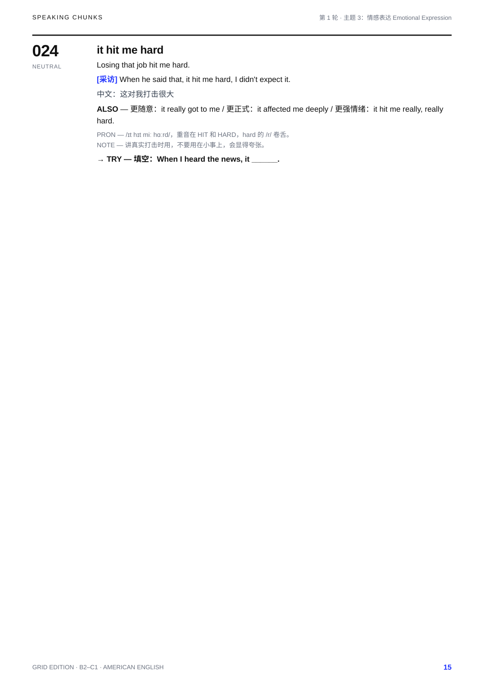
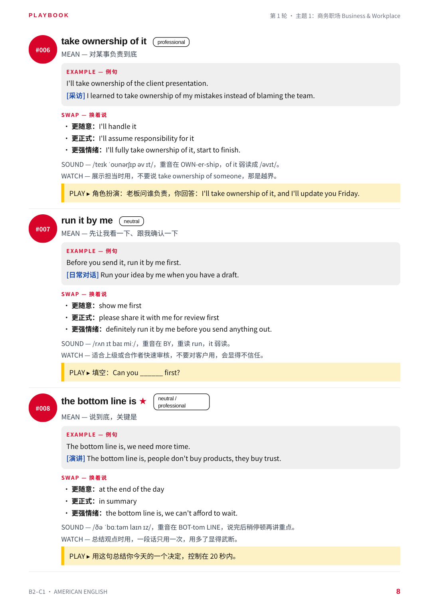
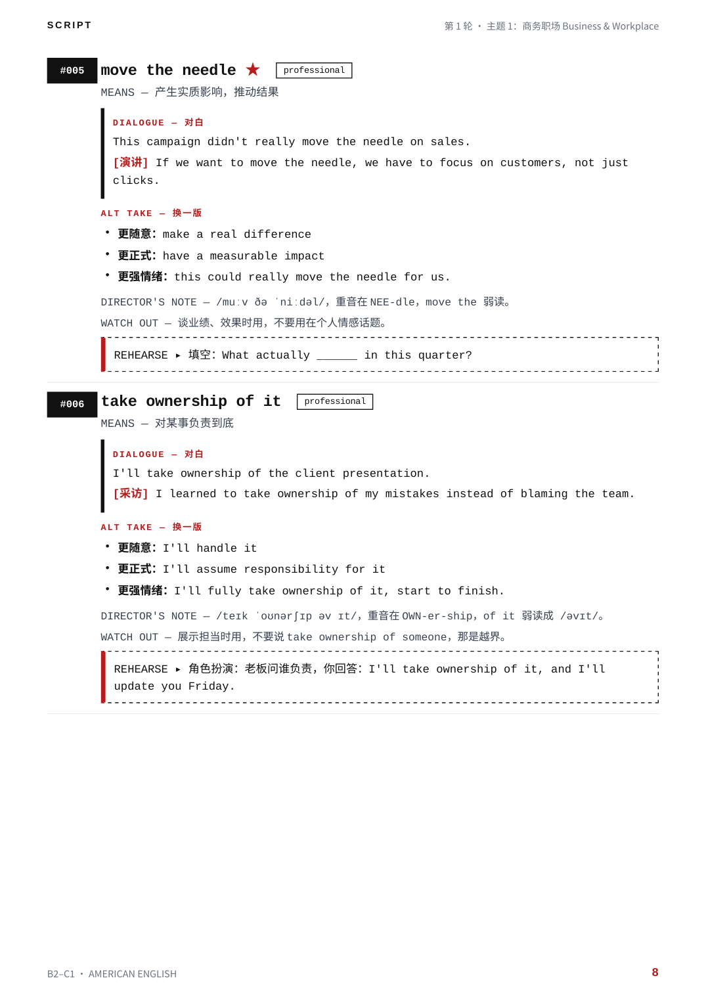
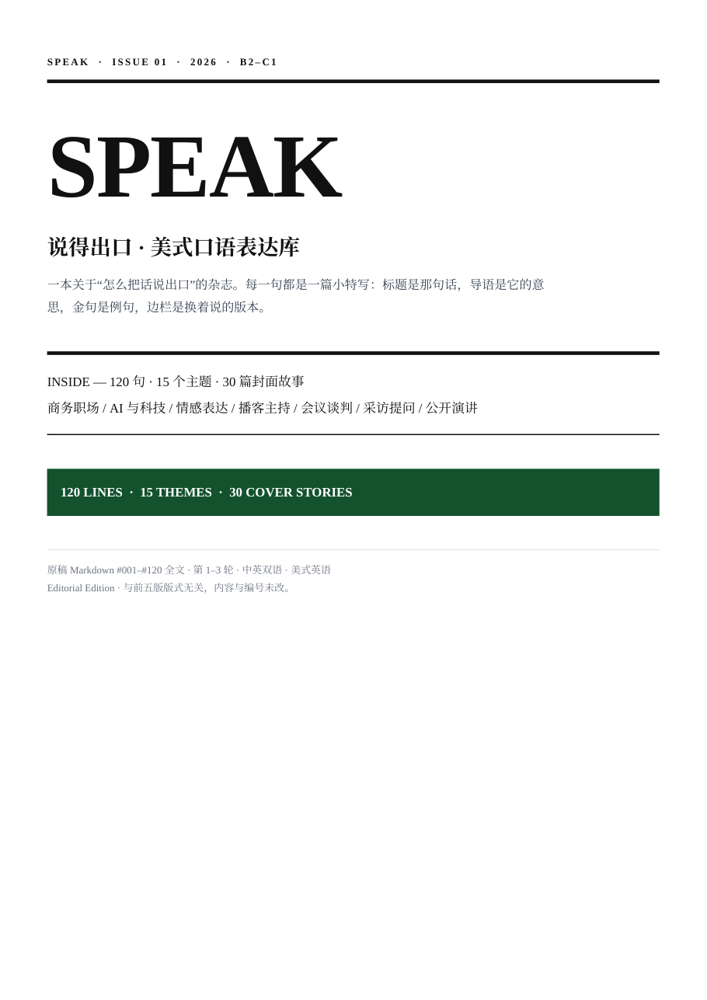
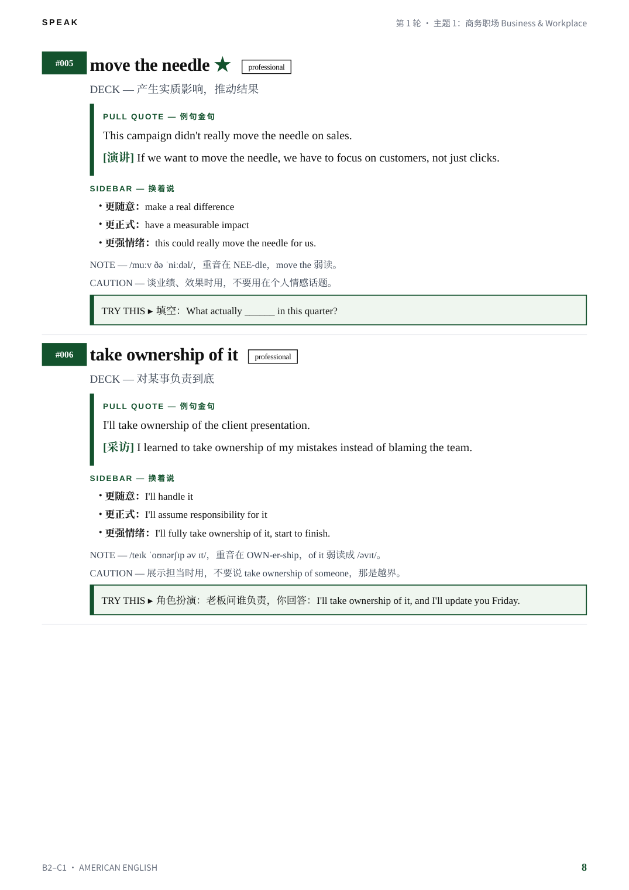

# markdown-to-pdf-styles

A style library for turning Markdown into PDF: pick a style first,
then generate. Same Markdown in, completely different books out.

The 7 styles in this first version were built around one example —
the American English Speaking Chunks book (3 rounds, 120 chunks,
B2–C1, Chinese + English, numbering #001–#120) — so you can see
exactly what each style does on the same content. That example is
in `examples/`; the styles themselves are the project, not the
example. See `SPEC.md` for the input format the current styles
expect, and its honest limitation: they currently expect that
example's shape, and generalising them to arbitrary Markdown is
future work, not something this version claims to do.

## The 7 styles

| Style | File | What it is for | Look |
|---|---|---|---|
| formal | `styles/formal.py` | Formal delivery, archiving | Navy cover, meta table, leader-dot contents, one card per chunk, gold core border |
| muse | `styles/muse.py` | Speaking practice, ticking off | Warm paper, serif English, orange accents, rounded practice cards with tick boxes |
| grid | `styles/grid.py` | Lookup, printing into a notebook | White paper, sans only, black rules, electric blue only, English first, Chinese as annotation, alphabetical index, 120-row checklist |
| playbook | `styles/playbook.py` | Playing, not studying | Bauhaus geometry (red circle, yellow semicircle, blue square, black bar), short SAY / MEAN / EXAMPLE / SWAP / SOUND / WATCH / PLAY labels, pick-your-10, 30-day challenge grid |
| script | `styles/script.py` | Rehearsing lines out loud | Typewriter mono, black + ribbon red only, script title page (FADE IN), LINE / MEANS / DIALOGUE / ALT TAKE / DIRECTOR'S NOTE / WATCH OUT / REHEARSE, scene list, take log |
| editorial | `styles/editorial.py` | Reading like a magazine | Serif masthead SPEAK, deep green only, headline / deck / pull quote / sidebar / note / caution / TRY THIS, editor's letter, cover stories, notes page |
| night | `styles/night.py` | Reading on screen at night | Dark pages, light type, amber only, SAY IT AFTER DARK cover, night rules, night picks, sleep-before-10, night sessions log. **For screens, not for print** — dark pages use a lot of ink |

Cover previews are in `gallery/` (`cover-<style>.png`).

## Generated output screenshots

These are real pages rendered from the PDFs that `build_all.py`
produces from `examples/American_English_Speaking_Chunks.md`
(130 dpi, not mock-ups). Each row shows the style's cover and one
interior chunk page, so you can judge the layout before building.

| Style | Cover | Interior page |
|---|---|---|
| formal |  |  |
| muse |  |  |
| grid |  |  |
| playbook |  |  |
| script |  |  |
| editorial |  |  |
| night |  |  |

All screenshots live in `gallery/` (`cover-<style>.png` for covers,
`page-<style>.png` for interior pages). The generated PDFs
themselves stay out of the repo — see `AGENTS.md` — and are
rebuilt with `python build_all.py`.

## Quick start

```bash
pip install -r requirements.txt
# One style:
python styles/night.py examples/American_English_Speaking_Chunks.md -o output/night.pdf
# Or all 7:
python build_all.py
# Or one style via the driver:
python build_all.py --style playbook
```

Each style script also works standalone:

```bash
python styles/<style>.py [input.md] [-o output.pdf]
```

Defaults (no arguments) read
`examples/American_English_Speaking_Chunks.md` and write to
`output/<style>.pdf`.

## Requirements

- Python 3.12 (tested with WeasyPrint 70; see `requirements.txt`)
- Fonts: Noto Sans CJK / Noto Serif CJK and Liberation family.
  On Debian/Ubuntu: `fonts-noto-cjk`, `fonts-liberation`.
  Without a CJK font, Chinese text will not render correctly.
- WeasyPrint is the renderer on purpose: the Chrome headless print
  path is not reliable in every environment, and WeasyPrint gives
  real page numbers in contents via `target-counter`.

## Input format

The input is a Markdown file with this structure (see `examples/`):

```markdown
## 第 1 轮总览
- 主题：商务职场、AI / 科技……
- 场景：播客、采访……
- 本轮 10 个最值得背的 chunk：Let's unpack that; Walk us through it; ……

## 第 1 轮 · 主题 1：商务职场 Business & Workplace

### 1. circle back on this
- 英文 chunk：circle back on this
- 中文意思：晚点再回头讨论这件事
- 正式度：professional
- 美式例句：(1) Let's circle back on this after we get the data. (2) [会议] I know we're short on time, so let's circle back on this on Thursday.
- 可替换说法：更随意：let's revisit this later / 更正式：……
- 美式发音与流利度提示：……
- 使用提醒：……
- 迷你练习：……

## 第 1 轮 · 7 天复习 / 练习计划
- Day 1：……
```

Each chunk is rendered in full, in source order, numbered #001…
from the file order. The “most worth memorising” lists in the round
overviews are matched back to chunks and marked with ★ (or the
style's equivalent) in the body and in the core-30 front section.

### Current limitation (honest, not hidden)

The current scripts expect the example's shape: 3 rounds, 120
chunks, and one 10-item core list per round. They assert those
counts and will fail on a differently shaped file instead of
silently producing a wrong book. Generalising the parser to
arbitrary chunk counts is the next TODO; it is not done in this
first public version.

## Reproducibility — same Markdown, same book, anywhere

This is a hard requirement, not a nice-to-have: someone else —
including another AI agent with no prior context — must be able
to clone this repo, take the same Markdown file, and produce the
same PDFs.

- **Read `SPEC.md` first.** It pins the exact environment
  (Python 3.12, WeasyPrint 70.0, CJK + Liberation fonts), the
  exact input format, and the expected page count for every style.
- **Read `AGENTS.md`** if you are an agent reproducing this:
  it is a 5-step checklist, and it tells you to stop and report
  instead of delivering a different book when a check fails.
- **Verify after building:** `python verify.py` (needs PyMuPDF,
  `pip install pymupdf`). It checks every PDF's page count and
  that #001–#120 are all present.
- **What can still differ:** PDF metadata (creation date etc.),
  so files are not byte-identical between runs. Visual layout,
  page counts, chunk order, numbering, and contents page numbers
  must be identical. If a page count differs by even one page,
  a font or the input shape changed — see `SPEC.md` section 6.
- **What this repo does not depend on:** no Chrome, no personal
  workspace path, no agent-specific tool. All default paths are
  relative to the repo root. The only external requirements are
  the pinned Python packages and the system fonts listed above.

## Repository layout

```
.
├── README.md
├── LICENSE
├── requirements.txt
├── build_all.py          # driver: build one or all styles
├── styles/
│   ├── formal.py
│   ├── muse.py
│   ├── grid.py
│   ├── playbook.py
│   ├── script.py
│   ├── editorial.py
│   └── night.py
├── examples/
│   └── American_English_Speaking_Chunks.md   # example input (120 chunks)
├── gallery/
│   └── cover-<style>.png  # cover previews, not full PDFs
└── output/               # generated PDFs go here (gitignored)
```

Generated PDFs are intentionally **not** committed: they are
4–5 MB each for the CJK fonts, and anyone can regenerate them with
one command above. The gallery covers are the showcase.

## License

MIT. See `LICENSE`.
